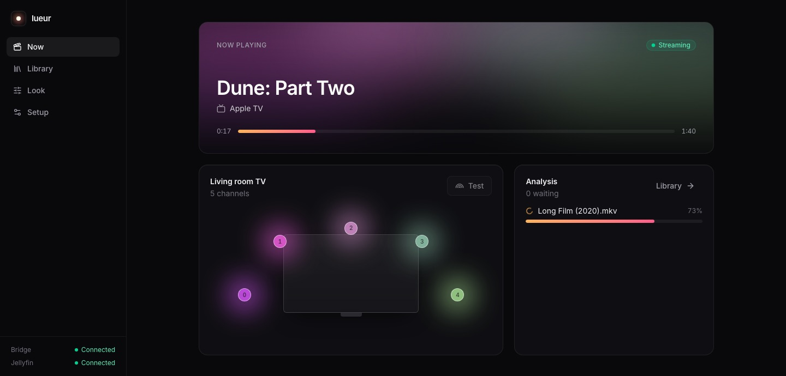
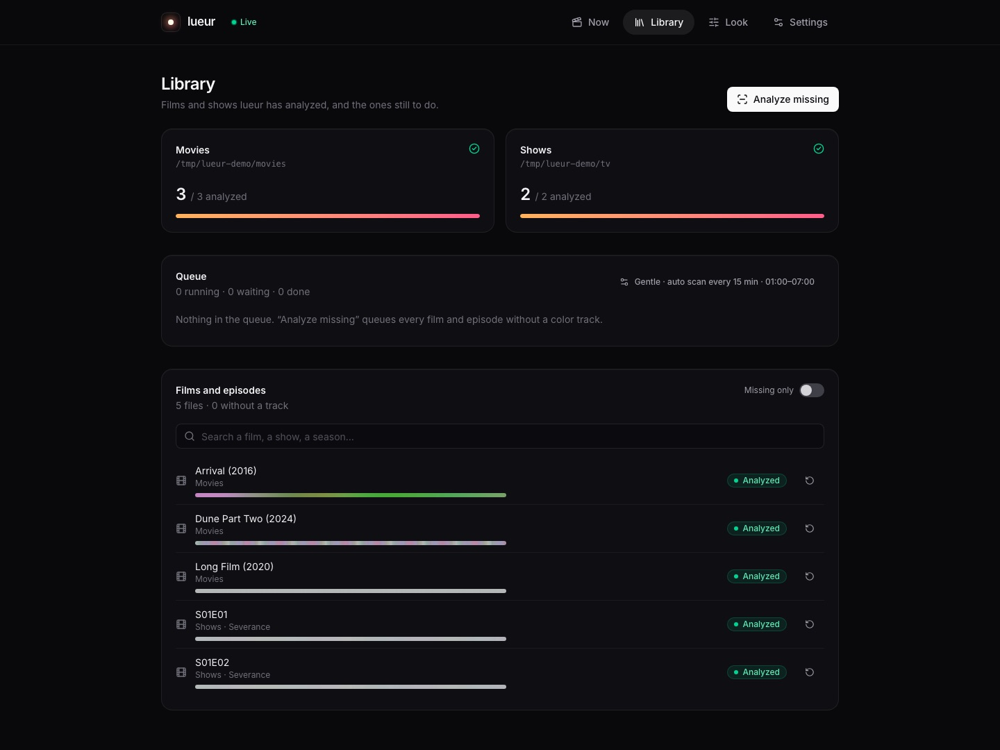
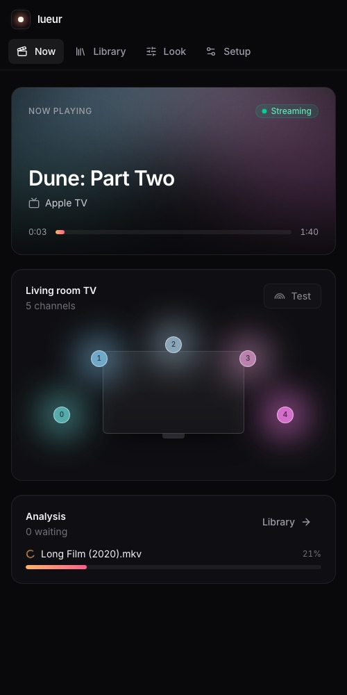
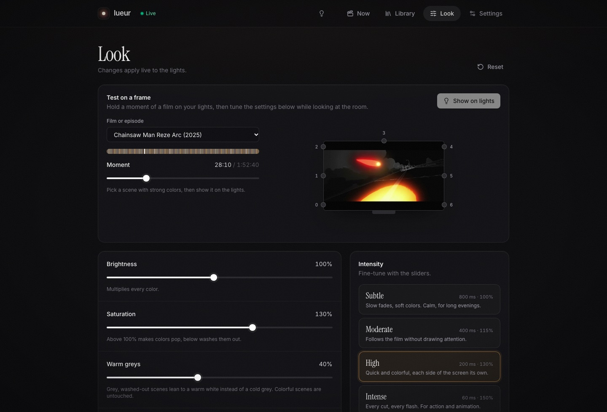

<div align="center">


# lueur

**Philips Hue ambilight for Jellyfin, from your home server.**
No Sync Box, no PC, no Hue Sync app: each film is analyzed once, then your lights follow the screen.

[](https://github.com/mathieuletyrant/lueur/pkgs/container/lueur)




</div>

## ✨ Features

**Sync**

- 🎬 **Any Jellyfin client**: Apple TV, TV, phone, browser. lueur follows playback, seeks and pauses
- 🌈 **Per-light colors**: each light of the Hue entertainment area takes the color of its side of the screen, 50 times per second
- 🎞️ **Black bars ignored**: letterbox and pillarbox are cropped before the colors are computed
- ⏱️ **Locked clock**: playback reports are pushed by Jellyfin's WebSocket and timed by lueur itself, the lights don't stutter between reports
- 🎚️ **Sync offset** on the Now page, to cancel a TV's or an app's delay
- 💤 **Lights come back**: when playback stops, the lights return to their previous state

**Analyze**

- ⚡ **Once per film**: ffmpeg decodes on the GPU (VA-API on Intel, VideoToolbox on macOS) and only keeps a tiny image per frame, many times faster than real time
- 📦 **Tiny tracks**: a 16×9 color grid 12 times per second, a few hundred KB per film
- 🔄 **Auto scan**: new films and episodes are found every 5 min to 6 h, tracks of deleted or replaced files are cleaned up
- 🔍 **On demand**: analyze everything missing, or a single film or episode from the list, stop at any time
- 🌡️ **Gentle on the server**: a speed preference from *Gentle* (5×) to *Hurt my GPU*, analysis hours, lowest CPU priority
- 🆕 **On first playback**: a film played without a track is analyzed first, and the lights join in as soon as it is done

**App**

- 🧭 **Guided setup**: bridge discovery and pairing, entertainment area, Jellyfin, libraries
- 🎚️ **Live look**: brightness, saturation, minimum brightness, smoothing and sync offset, applied during the film
- 💡 **Find a light**: click one in the area view and it blinks
- 🐳 **One container**: a single Rust binary serves the player, the API and the UI

<table>
  <tr>
    <td width="68%"></td>
    <td width="32%"></td>
  </tr>
</table>

## 🚀 Run it

### ☂️ Umbrel

Add the community app store `https://github.com/mathieuletyrant/umbrel-community-app-store`, install **lueur** and allow GPU access. Umbrel's Jellyfin and lueur both see your files under `/downloads`.

### 🐳 Docker

```sh
docker run -d --name lueur -p 8080:8080 \
  -v lueur-data:/data \
  -v /path/to/media:/media:ro \
  --device /dev/dri:/dev/dri \
  ghcr.io/mathieuletyrant/lueur:latest
```

Open http://localhost:8080 and follow **Setup**, then **Library → Scan now**.

| Env | Default | |
|---|---|---|
| `LUEUR_CONFIG` | `/data/lueur.json` | Config written by the UI; the tracks go to `tracks/` next to it |
| `LUEUR_PORT` | `8080` | |
| `RUST_LOG` | `lueur=info` | `lueur=debug` adds clock re-syncs |

The image is amd64, tagged `latest`, `x.y` and `x.y.z`. `--device /dev/dri` is optional: without a GPU, the analysis runs on the CPU.

> [!TIP]
> Bridge discovery uses the Hue cloud, which works from inside Docker, and mDNS, which needs `--network host`. You can always type the bridge's IP.

## 🪼 Jellyfin

1. Create an **API key** (Dashboard → API keys). It must be an admin key, to read file paths.
2. In lueur → Setup → Jellyfin, paste the server URL and the key. On Umbrel: `http://jellyfin_server_1:8096`.
3. Optionally, follow one device only, e.g. the living room Apple TV.

> [!TIP]
> When Jellyfin and lueur see the files under different paths (different containers or machines), pick lueur's folder for each library in Setup → Libraries.

## 💡 Hue

1. In the Hue app, create an **entertainment area** around your TV (Settings → Entertainment areas) and place the lights where they are.
2. In lueur → Setup, pick your bridge and press its link button.
3. Lights late or early on cuts? Use **Sync offset** on the Now page (±0.1 s buttons).



## 🛠️ Develop

You need Rust, ffmpeg, OpenSSL, Node 22 and pnpm. On macOS:

```sh
brew install rust ffmpeg openssl@3 pnpm
pnpm install
OPENSSL_DIR="$(brew --prefix openssl@3)" cargo run -- serve   # API + UI on :8080
pnpm dev             # UI with hot reload on :5173, proxies /api to :8080
pnpm check           # typecheck + cargo test
pnpm build           # UI, then the release binary with the UI inside
```

```
apps/server      Rust · tokio · axum · OpenSSL (DTLS) · ffmpeg
  src/analyze    ffmpeg decoding, black bars, color grid
  src/track      .lueur track format (zstd)
  src/hue        bridge REST API, discovery, Entertainment stream (DTLS 1.2 PSK)
  src/jellyfin   now playing, playback clock, libraries, devices
  src/player     Jellyfin → track → lights at 50 Hz, live status
  src/queue      background analysis queue
  src/server     `lueur serve`: HTTP API + embedded UI
apps/web         React 19 · Vite · Tailwind 4 · TypeScript
  src/views      one file per screen (Now, Library, Look, Setup)
  src/components area view, folder picker
```

The CLI stays for scripts and debugging: `lueur analyze <dirs> -j 2`, `lueur pair <ip>`, `lueur areas`, `lueur test`, `lueur run` (player only), `lueur inspect track.lueur --at 754`.

### 📦 Releases

Fully automatic, driven by [Conventional Commits](https://www.conventionalcommits.org) (`feat:` → minor, `fix:` → patch):

1. Every push to `main` opens or updates a **release PR** with the next version and the CHANGELOG.
2. Merging it creates the tag and GitHub release, then builds and publishes the Docker image.

📖 Vocabulary: [GLOSSARY.md](GLOSSARY.md) · 🧭 Decisions: [docs/adr](docs/adr)
